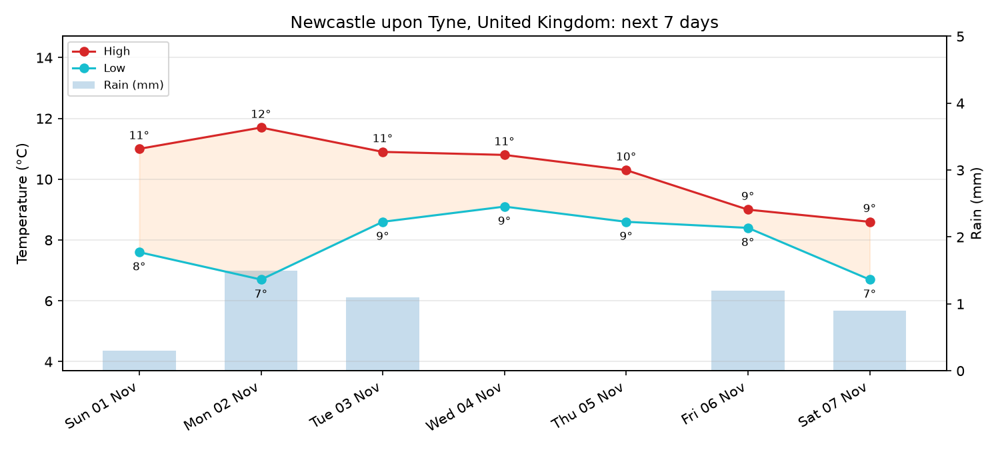

# weather-app

A small command-line tool that fetches a daily weather forecast for any city from
[Open-Meteo](https://open-meteo.com/) (free, no API key), prints it as a table, and
saves a chart.



## Requirements

- Python 3.12+
- [uv](https://docs.astral.sh/uv/)

## Install

```bash
git clone https://github.com/Bsujantho/weather_app.git
cd weather_app
uv sync
```

## Usage

```bash
uv run weather-app                      # Newcastle upon Tyne, next 7 days
uv run weather-app "Tokyo"              # any city by name
uv run weather-app "Paris" -d 14        # up to 16 days
uv run weather-app "Sydney" -o charts/sydney.png
```

| Option | Description | Default |
| --- | --- | --- |
| `city` | Place name to look up | `Newcastle upon Tyne` |
| `-d`, `--days` | Number of forecast days (1–16) | `7` |
| `-o`, `--out` | Where to save the chart (folders are created if needed) | `forecast.png` |

`python main.py` accepts the same arguments.

### Example output

```
Newcastle upon Tyne, United Kingdom — next 7 days

      Date  High (°C)  Low (°C)  Rain (mm)  Rain chance (%)
Sun 01 Nov       11.0       7.6        0.3               96
Mon 02 Nov       11.7       6.7        1.5               70
Tue 03 Nov       10.9       8.6        1.1               59
...

Saved forecast.png
```

The chart plots daily high and low temperatures with labelled values, plus daily
rainfall as bars on a second axis.

## How it works

1. The city name is resolved to coordinates and a timezone with the
   [Open-Meteo Geocoding API](https://open-meteo.com/en/docs/geocoding-api)
   (the first match is used).
2. Daily max/min temperature, precipitation total, and max precipitation
   probability are fetched from the
   [Open-Meteo Forecast API](https://open-meteo.com/en/docs).
3. The results are printed with pandas and plotted with matplotlib.

If the city can't be found or the network request fails, the tool prints an error
and exits with status 1.

## Project layout

```
src/weather_app/__init__.py   # all logic: geocoding, fetching, plotting, CLI
main.py                       # thin wrapper so `python main.py` works
pyproject.toml                # dependencies and the `weather-app` command
```

## Data attribution

Weather data by [Open-Meteo.com](https://open-meteo.com/), licensed under
[CC BY 4.0](https://creativecommons.org/licenses/by/4.0/).
